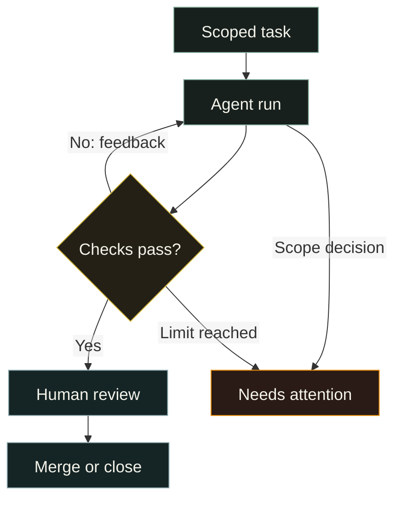

SuperPlane is an open source software factory that coordinates engineering tasks across coding agents, automated checks and human review. Your team defines the workflow, chooses the tools and controls when changes are ready to merge.

## The parts of a software factory

A task describes the result you need. Agents perform the engineering work, while automations coordinate execution and record the evidence needed for review.

<dl class="sp-glossary factory-concepts-parts not-content">
  

    <dt><a href="/fundamentals/work-intake">Task</a></dt>
    <dd>A scoped request with repository context, an expected result and acceptance checks. Imported tasks retain a link to their source issue.</dd>
  

  

    <dt><a href="/fundamentals/implement">Agent</a></dt>
    <dd>The worker that inspects code, implements the requested change and runs the available checks using the task and repository instructions.</dd>
  

  

    <dt><a href="/fundamentals/automations">Automation</a></dt>
    <dd>The workflow that defines triggers, tools, agent steps, checks and routes for success, failure or a human decision.</dd>
  

  

    <dt><a href="/fundamentals/factory-pipeline">Run</a></dt>
    <dd>One execution of an automation for a task, with its inputs, outputs, artifacts and failures recorded.</dd>
  

  

    <dt><a href="/fundamentals/verify">Verification</a></dt>
    <dd>The build, tests, continuous integration (CI) checks and pull request feedback used to evaluate the result.</dd>
  

  

    <dt><a href="/fundamentals/verify">Human review</a></dt>
    <dd>Your team's decision about the proposed change, including questions that require product, security or operational judgment.</dd>
  

</dl>

<figure class="sp-media-figure sp-media-figure--flush not-content">
  
  <figcaption>The board shows each task's stage, activity and linked pull request.</figcaption>
</figure>

## From a task to a reviewable result

A factory connects the request, implementation and verification in one workflow. Configure it to return failed checks to the agent with the relevant output and to pause when work needs a person's decision.

Passing checks lead to human review. Failed checks return evidence for another attempt within your configured retry limit; unresolved scope decisions or exhausted attempts pause for attention.

For example, a [dependency update](/use-cases/dependency-updates) can name one package, its target version and required tests. The agent updates the dependency files and permitted compatibility code. If a check fails, the workflow returns its output for correction; a change outside the task's scope needs a person's decision. The reviewer inspects the resulting pull request and check results before deciding whether to merge.

The [Factory pipeline](/fundamentals/factory-pipeline) explains each stage and its exit conditions. Task completion follows the [configured Done rule](/fundamentals/done).

## What your team controls

Define the rules before starting a task:

- **Scope and context:** Specify the repository, expected behavior, permitted changes and instructions the agent receives.
- **Tools and execution:** Choose the [model source](/billing/model-sources), integrations and runner environment used by the workflow.
- **Checks and decisions:** Define required checks, retry limits and approval points, including when work must pause for a person.

Use [automations](/fundamentals/automations) to configure these steps and inspect their execution on the canvas.

<figure class="sp-media-figure sp-media-figure--flush not-content">
  
  <figcaption>Inspect the automation and review proposed canvas changes before saving them.</figcaption>
</figure>

## What open source enables

The [SuperPlane repository](https://github.com/superplanehq/superplane) makes the factory implementation available for inspection and contribution. You can adapt the workflow to your engineering tools and choose how to operate it.

- **Inspect the implementation:** Review the engine, integration components and execution logic in the source.
- **Customize the process:** Edit automations, connect components and [contribute changes](/open-source/contributing) when your workflow needs additional behavior.
- **Choose where it runs:** Use [SuperPlane Cloud](https://app.superplane.com/) or follow the [self-hosting guides](/self-hosting/overview) for deployment options and their license requirements.

See [Why SuperPlane is open source](/open-source/why-open-source) for the project's licensing and operating model.

## Start with a task you can verify

Choose a focused task with an observable result, such as a dependency update, a reproducible test failure or a small interface fix. Include the acceptance checks and identify who handles unresolved decisions. Use [Factory performance](/fundamentals/factory-performance) to review outcomes, time and cost before expanding the workflow.

## Next steps

  <a href="/fundamentals/factory-pipeline"><strong>Follow the Factory pipeline</strong>Understand stages, task state and completion rules.</a>
  <a href="/fundamentals/automations"><strong>Configure automations</strong>Choose the tools, checks and failure routes for each stage.</a>
  <a href="/get-started/build-first-factory"><strong>Build your first Factory</strong>Connect a repository and complete a task through review.</a>
  <a href="/self-hosting/overview"><strong>Explore self-hosting</strong>Choose a deployment option for your environment.</a>

