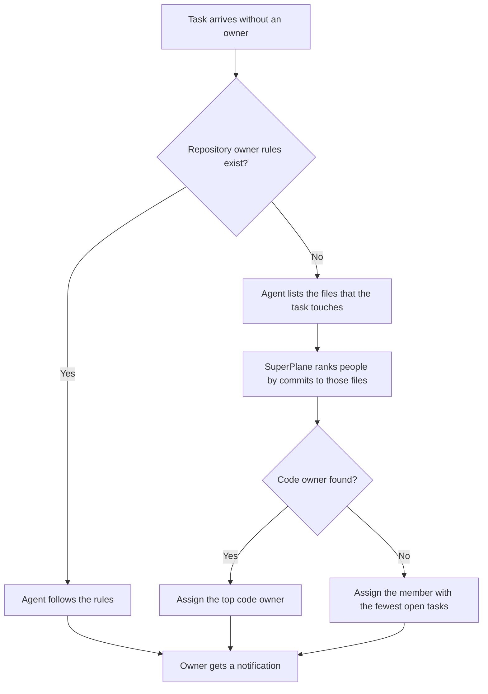

SuperPlane assigns an owner to each task that arrives without one. The agent picks the person who changed the code that the task touches. When nobody changed that code, SuperPlane picks the member with the fewest open tasks. This page explains how the owner is picked, what each person must set up, and how a repository can change the rules.

## Why tasks need an owner

Exceptions, production problems, and security reports arrive at any hour. A task without an owner stays on the board, and nobody drives the fix to production. With an owner, a CVE that arrives at 3 AM has a plan and a responsible person in the morning.

## How SuperPlane picks the owner

Assignment runs during task refinement, when the agent reads the repository and writes the plan. It runs once, on the first refinement turn, and only when the task has no owner.



The agent follows the repository rules when the file exists. Otherwise, SuperPlane ranks people by code history, and board load breaks ties or fills in when no code owner exists.

SuperPlane ranks code owners with the GitHub commit history of the files:

- It reads commits from the last 180 days.
- Recent commits count more than old commits.
- It skips bots and commits that the SuperPlane agent co-authored.
- It breaks ties by the number of open tasks. Draft and open tasks in the same workspace count as open.

If the agent does not assign an owner, SuperPlane assigns the member with the fewest open tasks when the first plan is published. Every task that goes through refinement gets an owner.

## Who can own a task

A person can own a task when all of these are true:

- The person is an active member of the organization.
- The person is a human user, not a service account.
- The person has a GitHub account in **Settings > Account > Associated accounts**.

The associated GitHub account connects commit authors to SuperPlane members. Without it, SuperPlane cannot match code history to you, and you do not get tasks from board load either. Your sign-in method does not count. Link the account in **Associated accounts** even if you sign in with GitHub.

To make yourself eligible:

1. Open **Settings > Account**.
2. In **Associated accounts**, click **Link GitHub**.
3. Approve access in GitHub.

## Assignment never replaces a person

SuperPlane only assigns an owner when the task has none. These owners stay in place:

- the person who created the task
- the default owner of an intake
- a person who sent a refinement message or answered a question

Change the owner from the task at any time. SuperPlane does not change it back.

## Write owner rules for your repository

Add `.superplane/skills/task-owner.md` to the repository of the workspace to set your own rules. The runner reads the file and adds it to the first refinement prompt. The agent follows these rules before it looks at code history.

Name people by GitHub login. First names can match more than one person.

```markdown
CVE security problems go to @mijat.
Sentry exceptions in payments go to @pedro.
A production problem in the web app goes to the person who last changed that screen.

Everything else goes to the person with the fewest open tasks.
```

The rules only pick from people who can own a task. If a rule names a person without an associated GitHub account, SuperPlane rejects that choice.

**Note:** The runner reads at most 8 KB of the file. It ignores symbolic links and files outside the repository.

## Notifications for the new owner

When a person becomes the owner of a task, SuperPlane notifies that person. The notification names the task and shows the reason for the choice, for example: "You changed `pkg/payments/refunds.go` 6 times in the last 30 days."

The notification type is **Tasks assigned to you**. It applies to automatic and manual assignments. The person who makes a manual change does not get a notification.

Default settings send this notification by email. If you saved a custom list of notification types before this feature, turn on **Tasks assigned to you** in **Settings > Notifications**.

The task activity also shows the assignment. An automatic assignment reads "SuperPlane assigned" with the reason below it.

## Limits

- Code history uses the GitHub integration of the workspace. Bitbucket repositories use board load only.
- Assignment runs during refinement. Tasks that skip refinement keep the owner they arrived with.
- The agent sends at most 10 paths for each task. A task that touches more code ranks owners by those 10 paths.
- SuperPlane ignores owner instructions inside the task text, attachments, and intake data. Only the repository file and a person can set the owner.
