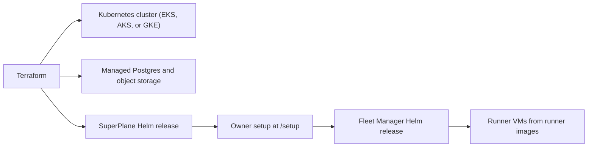

import { Aside, LinkCard, CardGrid } from "@astrojs/starlight/components";

Run SuperPlane on your own machines. [Install on a single VM](/self-hosting/single-vm) uses Docker Compose on one Linux machine. [Install on your cloud](/self-hosting/install) uses Terraform and Kubernetes on AWS, Azure, or Google Cloud. You then create the owner account. Cloud installs also install Fleet Manager from the browser.

<Aside type="caution" title="Kubernetes installations require Enterprise">
You need a SuperPlane Enterprise license to install on Amazon Elastic Kubernetes Service (EKS), Azure Kubernetes Service (AKS), or Google Kubernetes Engine (GKE). [Contact sales](https://superplane.com/demo/) before you start if you do not have a license file or license key.
</Aside>

Terraform creates the cluster and the application. Owner setup installs Fleet Manager, which starts the runner virtual machines.

The browser steps are the same on each cloud. Three things differ:

- **AWS.** DNS is a CNAME to the load balancer, after Terraform. Runner images are public AMIs in `us-east-1`.
- **Azure.** DNS is an A record to the load balancer, after Terraform. Runner images are in the SuperPlane community gallery.
- **Google Cloud.** Create the static IP and the A record before Terraform. Public runner images are not published yet. Build the runner image with Packer before Terraform.

The cloud account pays for the cluster, the database, the load balancer, and any runner machines that stay running.

<CardGrid>
  <LinkCard
    title="Install on a single VM"
    href="/self-hosting/single-vm"
    description="Install Docker Compose on one Linux machine, create the owner account, and start runners."
  />
  <LinkCard
    title="Install on your cloud"
    href="/self-hosting/install"
    description="Install SuperPlane Enterprise on Kubernetes in AWS, Azure, or Google Cloud."
  />
  <LinkCard
    title="Troubleshooting"
    href="/self-hosting/troubleshooting"
    description="Quota, DNS, certificate, and runner errors."
  />
  <LinkCard
    title="Upgrade and uninstall"
    href="/self-hosting/upgrade-and-uninstall"
    description="Move to a newer chart, or remove the installation."
  />
</CardGrid>
