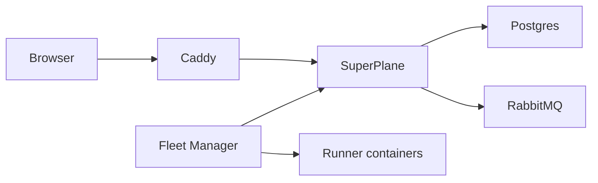

import { Aside, Steps } from "@astrojs/starlight/components";

Install SuperPlane on one Linux VM with Docker Compose. You need a DNS name that points at the VM before you start. Plan for 30 minutes. Runner tasks are optional and run as containers on the same VM.



Caddy receives HTTPS on ports 80 and 443. SuperPlane stores data in Postgres and files on a local volume. When you enable runners, Fleet Manager starts one runner container for each task.

## Requirements

- Ubuntu 24.04 on a 64-bit VM.
- 4 vCPUs, 16 GB of memory, and 100 GB of disk. A runner task can use 8 GB of memory. The default fleet runs at most 2 tasks at a time.
- A DNS A record for the name you will use, such as `superplane.example.com`. The record must point at the VM before you install.
- Inbound TCP 22, 80, and 443. Do not publish any other application port.

<Aside type="caution">
The installer writes secrets into `superplane.env`. Copy that file off the VM after install. If you lose `ENCRYPTION_MASTER_KEYS`, SuperPlane cannot decrypt stored secrets.
</Aside>

## 1. Install Docker

Install Docker Engine and the Compose plugin from the Docker apt repository.

```bash
sudo apt-get update
sudo apt-get install -y ca-certificates curl
sudo install -m 0755 -d /etc/apt/keyrings
sudo curl -fsSL https://download.docker.com/linux/ubuntu/gpg -o /etc/apt/keyrings/docker.asc
sudo chmod a+r /etc/apt/keyrings/docker.asc
echo "deb [arch=$(dpkg --print-architecture) signed-by=/etc/apt/keyrings/docker.asc] https://download.docker.com/linux/ubuntu $(. /etc/os-release && echo "$VERSION_CODENAME") stable" | sudo tee /etc/apt/sources.list.d/docker.list >/dev/null
sudo apt-get update
sudo apt-get install -y docker-ce docker-ce-cli containerd.io docker-buildx-plugin docker-compose-plugin
sudo systemctl enable --now docker
sudo usermod -aG docker "$USER"
```

Open a new login shell so your user can run Docker. `docker compose version` prints a v2 version.

## 2. Download the release

`@@SUPERPLANE_IMAGE_TAG@@` is the current SuperPlane release. The archive contains Compose, the installer, and Caddy.

```bash
VERSION=@@SUPERPLANE_IMAGE_TAG@@
curl -fsSL -o superplane-single-host.tar.gz \
  "https://github.com/superplanehq/superplane/releases/download/${VERSION}/superplane-single-host.tar.gz"
tar -xzf superplane-single-host.tar.gz
cd superplane
```

## 3. Install SuperPlane

Run the installer from the `superplane` directory. Enter the DNS name when it asks. Do not include `https://`.

```bash
./install.sh
```

The installer writes `superplane.env` and `rabbitmq.env` with mode `600`, creates an OIDC key in `oidc/`, and starts the stack. `rabbitmq.env` holds only the RabbitMQ user and password. Postgres, RabbitMQ, and file storage use Docker volumes. RabbitMQ is not published on the host.

Caddy requests a certificate from Let's Encrypt. The DNS name must already point at this VM, and ports 80 and 443 must be open.

Confirm the services and the health check:

```bash
docker compose ps
curl -fsS "https://superplane.example.com/health"
```

Every service is `running` or `healthy`. The health check returns HTTP 200 and no body.

## 4. Create the owner account

Open `https://superplane.example.com/setup`.

<Steps>

1. On **Create the owner account**, enter the name, email, and password. The password needs 8 or more characters, one number, and one capital letter. Select **Continue**.

   <figure class="sp-media-figure not-content">
     
     <figcaption>Create the owner account.</figcaption>
   </figure>

2. On **Choose an edition**, select **Continue with Community**. Select **Enterprise** only when you have a license file or a license key.

   <figure class="sp-media-figure not-content">
     
   </figure>

3. On **Send email from this installation**, select **Skip for now**. You can add SMTP later in installation settings.

   <figure class="sp-media-figure not-content">
     
   </figure>

</Steps>

## 5. Start runners

Runner nodes, including Run Bash and factory agents, need Fleet Manager. Skip this step when you do not need those nodes.

1. On **Set up runner fleets**, select **Set up fleets**.
2. Select **This VM**, then select **Continue**.
3. On **Start runners on this VM**, copy the command. Run it in the install directory.

The command starts with `./enable-runners.sh` and includes an installation admin token. The page creates that token. Do not type a token by hand.

The script writes `fleet-manager.env` with mode `600`, pulls the runner image, and starts Fleet Manager. The first pull is large. Fleet Manager then starts a runner container on the `superplane_default` network for each task and removes it when the task finishes. The page shows **Finish installation** when the fleet is ready.

<Aside type="caution" title="Docker socket">
Fleet Manager mounts the Docker socket. That socket can control every container on the VM. Enable runners only on a machine you administer.
</Aside>

Create a canvas with a Run Bash node and run it. A container named `superplane-runner-` appears in `docker ps` while the task runs.

## Configuration

`superplane.env` holds the install configuration. `./install.sh` adds missing keys and keeps existing secrets. Do not delete these values:

| Key | Purpose |
| --- | --- |
| `BASE_URL` | Public `https://` URL. Caddy uses `SUPERPLANE_DOMAIN`. |
| `DB_PASSWORD` | Postgres password. Also set as `POSTGRES_PASSWORD`. |
| `RABBITMQ_URL` | App connection to RabbitMQ. The broker is not on the host network. |
| `ENCRYPTION_KEY` and `ENCRYPTION_MASTER_KEYS` | Decrypt data that SuperPlane stores. |
| `JWT_SECRET` | Sign login tokens. |
| `BLOB_STORAGE_SIGNING_KEY` | Sign file download URLs. Files are stored at `BLOB_STORAGE_LOCAL_PATH`. |
| `OIDC_KEYS_PATH` | Directory of the OIDC signing key. The key file is in `oidc/` on the host. |

`fleet-manager.yaml` selects the fleet for this machine: `e1-large-amd64` or `e1-large-arm64`. `maxCapacity` is `2`. Raise it only when the VM has memory for more 8 GB tasks.

To send email, set `RESEND_API_KEY`, `EMAIL_FROM_NAME`, and `EMAIL_FROM_ADDRESS` in `superplane.env`, then run `docker compose up -d`.

## Persistent storage

| Volume | Contents |
| --- | --- |
| `postgres-data` | SuperPlane database |
| `blob-data` | Uploaded files |
| `rabbitmq-data` | Queue state |
| `runner-active-logs` | Runner logs before they are stored |
| `caddy-data` | Certificates |
| `oidc/` on the host | OIDC signing key |

`docker compose restart` and a VM reboot keep these volumes. `docker compose down -v` deletes them.

## Health and restarts

Each service uses `restart: always`. Docker starts the stack after a reboot.

```bash
docker compose ps
curl -fsS "https://superplane.example.com/health"
docker compose logs app --tail=80
```

`docker compose restart` restarts every service. Log files rotate at 50 MB, with 5 files kept for each service.

## Backup and restore

Run the backup from the install directory. Copy the backup directory off the VM.

```bash
mkdir -p "$HOME/superplane-backup"
docker compose exec -T db pg_dump -U postgres -Fc superplane >"$HOME/superplane-backup/superplane.dump"
tar -czf "$HOME/superplane-backup/config.tar.gz" superplane.env rabbitmq.env oidc fleet-manager.yaml fleet-manager.env Caddyfile
docker run --rm \
  -v superplane_blob-data:/data:ro \
  -v "$HOME/superplane-backup":/backup \
  alpine tar -C /data -czf /backup/blobs.tar.gz .
```

Restore onto a new VM that does not already run this Compose project. Extract the same release, then restore the config before you start the app.

```bash
mkdir -p "$HOME/superplane-restore"
tar -C "$HOME/superplane-restore" -xzf superplane-single-host.tar.gz
cd "$HOME/superplane-restore/superplane"
tar -xzf "$HOME/superplane-backup/config.tar.gz"
docker compose up -d db
docker compose exec -T db pg_restore -U postgres -d superplane --clean --if-exists <"$HOME/superplane-backup/superplane.dump"
docker run --rm \
  -v superplane_blob-data:/data \
  -v "$HOME/superplane-backup":/backup \
  alpine tar -C /data -xzf /backup/blobs.tar.gz
docker compose up -d --wait
```

Log in with the owner account from the backup. Canvases and uploaded files are present. A wrong `superplane.env` makes stored secrets fail to decrypt.

## Upgrade

Download the new `superplane-single-host.tar.gz`. From the existing install directory, replace the Compose file and the scripts. Leave `superplane.env`, `oidc/`, `fleet-manager.env`, and `Caddyfile` in place.

```bash
mkdir -p /tmp/superplane-release
tar -C /tmp/superplane-release -xzf superplane-single-host.tar.gz
cp /tmp/superplane-release/superplane/docker-compose.yml .
cp /tmp/superplane-release/superplane/install.sh .
cp /tmp/superplane-release/superplane/enable-runners.sh .
chmod +x install.sh enable-runners.sh
./install.sh
```

`./install.sh` keeps the existing secrets, pulls the new images, and migrates the database on startup. When runners are already enabled, run `./enable-runners.sh` again with the same token so Fleet Manager uses the new runner image.

## Uninstall

<Aside type="danger" title="Uninstall deletes the data">
`docker compose down -v` deletes the database, files, queue data, and certificates. Copy the backup off the VM first.
</Aside>

```bash
docker compose --profile runners down -v --remove-orphans
```

Delete `superplane.env`, `rabbitmq.env`, `fleet-manager.env`, and `oidc/` after the backup is stored somewhere else. Those files can decrypt the database.
